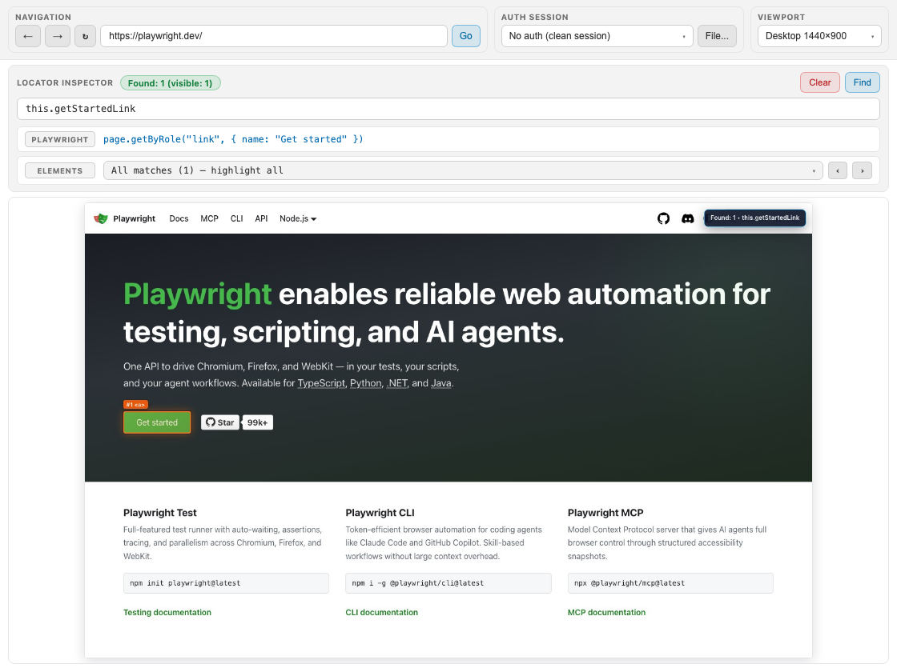

# Playwright Locator Inspector

[English](#english) | [Русский](#русский)

---

<a id="english"></a>

## English

A VS Code extension that embeds an interactive Chromium browser inside an editor tab and provides real-time Playwright locator inspection, DOM match counts in the editor gutter, and live element highlighting directly from TypeScript/JavaScript code (Page Objects, helpers, and tests).

### Preview

#### Embedded Browser & Theme Support

The inspector automatically adapts to your active VS Code color theme (Dark, Light, and High Contrast).

**Dark theme:**


**Light theme:**



#### Live Editor Gutter & Selection Feedback

While the inspector browser is open, match counts appear directly in the left editor gutter and update dynamically as you type or navigate. Selecting a locator expression also shows a subtle inline match counter on the right.


### Features

- **Embedded Interactive Browser** (`Playwright: Open Browser Inspector`):
  - Live browser view streamed over CDP Screencast (`Page.startScreencast` + `Page.screencastFrameAck`) with mouse, scroll, and keyboard forwarding.
  - **Navigation** bar with Back, Forward, Reload, and URL input.
  - **Auth session** selector that discovers valid Playwright `storageState` `.json` files (validated against `cookies` / `origins` schemas, with cookie/origin counts shown on hover) and lets you browse any custom file on disk.
  - **Viewport** switcher (`Desktop 1440×900`, `Desktop 1920×1080`, `Mobile 393×851`) with aspect-ratio-preserving preview scaling.
  - Automatic adaptation to the current VS Code color theme.

- **Locator Inspector & Snippet Search**:
  - Click **Show Locator in Browser** from the editor context menu (or press `Cmd+Shift+L` / `Ctrl+Shift+L`) on any locator in code.
  - Paste any Playwright locator chain, Page Object property, or CSS/XPath selector into the **Locator inspector** input and press `Enter` or **Find**.
  - Inspect resolved Playwright chains, switch between matched elements via the **Elements** dropdown or `‹` / `›` buttons, and test parameterized helpers/methods via variant chips or custom parameter input.

- **Safe AST Locator Resolver (`line + column`)**:
  - Analyzes the live editor buffer (`document.getText()`), including unsaved changes.
  - Distinguishes nested vs. outer locators at the cursor position.
  - Safely strips terminal action/assertion calls (`.click()`, `.fill()`, `.check()`, `.hover()`, `.press()`, `.waitFor()`, `expect(...).toBeVisible()`) so elements are highlighted without side effects.
  - Resolves `this.*` properties, nested section objects, constructor variables, local factory functions, and imported constant objects.

- **Live Editor Feedback**:
  - **Gutter counters** on the left automatically scan all locators in the active editor while the browser tab is open, update dynamically while typing or navigating, and clear immediately when the browser tab closes:
    - Green (`1`) — unique match in DOM
    - Amber (`2+`) — multiple matches in DOM
    - Red (`0`) — not found in DOM
    - Blue (`N/M`) — parameterized helper variants matched
  - Hovering a gutter badge displays the resolved Playwright chain and a clickable **Highlight in browser** link.
  - Selecting a locator fragment shows a subtle inline match badge on the right.

- **Zero Bundled Browsers**:
  - Dynamically uses `@playwright/test`, `playwright`, or `playwright-core` from your workspace `node_modules` and automatically applies `use.testIdAttribute` and `baseURL` from `playwright.config.*`.

### Usage

1. Open a Playwright Page Object, helper, or test file (`.ts`, `.tsx`, `.js`, `.jsx`).
2. Click the globe icon in the editor title bar (**Playwright: Open Browser Inspector**) or run it from the Command Palette (`Cmd+Shift+P` / `Ctrl+Shift+P`).
3. Optionally choose a `storageState` file under **Auth session** and navigate to the target URL.
4. View live match counts in the editor gutter, select any locator snippet for quick inline verification, or right-click a locator and choose **Show Locator in Browser** (`Cmd+Shift+L` / `Ctrl+Shift+L`).

### Extension Settings

| Setting | Default | Description |
| --- | --- | --- |
| `pwLocatorInspector.defaultUrl` | `""` | Default URL when opening the browser (falls back to `baseURL` from `playwright.config`). |
| `pwLocatorInspector.viewportWidth` | `1440` | Default browser viewport width. |
| `pwLocatorInspector.viewportHeight` | `900` | Default browser viewport height. |
| `pwLocatorInspector.storageStatePath` | `""` | Relative or absolute path to a Playwright `storageState` (`.json`) file. |

### Build & Package

```bash
npm install
npm run typecheck
npm run build
npm run verify
npm run package
```

### Credits

Created by **Rudoi S.** with AI assistance.

---

<a id="русский"></a>

## Русский

Расширение для VS Code, которое открывает интерактивный браузер Chromium прямо во вкладке редактора, показывает количество совпадений локаторов в реальном времени и подсвечивает найденные элементы на странице прямо из TypeScript/JavaScript-кода (Page Object, хелперы, тесты).

### Превью

#### Встроенный браузер и поддержка тем VS Code

Интерфейс расширения автоматически подстраивается под выбранную тему VS Code (тёмную, светлую или высококонтрастную).

**Тёмная тема:**


**Светлая тема:**


#### Индикация в редакторе (gutter слева и бейдж при выделении)

Пока открыто окно браузера инспектора, слева от номеров строк автоматически отображается количество найденных в DOM элементов для каждого локатора в файле. При закрытии окна браузера индикаторы убираются, а при написании нового локатора — обновляются динамически. При выделении фрагмента локатора справа выводится мягкий инлайн-бейдж с числом совпадений.


### Возможности

- **Встроенный интерактивный браузер** (`Playwright: Open Browser Inspector`):
  - Живой поток экрана через CDP Screencast (`Page.startScreencast` + `Page.screencastFrameAck`) с пробросом кликов, скролла и клавиатурного ввода.
  - Блок **Navigation**: кнопки «Назад», «Вперёд», «Обновить» и адресная строка.
  - Блок **Auth session**: автоматический поиск валидных файлов `storageState` (`.json` со схемой `cookies` / `origins`; число cookie и origins выводится во всплывающей подсказке) и выбор произвольного файла через **File...**.
  - Блок **Viewport**: переключение разрешений (`Desktop 1440×900`, `Desktop 1920×1080`, `Mobile 393×851`) с сохранением пропорций экрана.
  - Автоматическая адаптация фона и элементов под текущую тему VS Code.

- **Инспектор локатора и ручной поиск** (**Locator inspector**):
  - Вызов по правой кнопке мыши **Show Locator in Browser** или сочетанием `Cmd+Shift+L` / `Ctrl+Shift+L` на любом локаторе в коде.
  - Поддержка вставки готовых цепочек Playwright, обращений к свойствам и чистых CSS/XPath-селекторов.
  - Переключение между найденными элементами через выпадающий список **Elements** и кнопки `‹` / `›`.
  - Поддержка параметризованных методов и хелперов (выбор готовых вариантов или ввод своего значения параметра).

- **Безопасный AST-резолвер (`line + column`)**:
  - Анализирует актуальный текст редактора (`document.getText()`), даже если файл ещё не сохранён.
  - Точно различает вложенные и внешние локаторы по позиции курсора.
  - Безопасно отрезает терминальные действия и проверки (`.click()`, `.fill()`, `.check()`, `.hover()`, `.press()`, `.waitFor()`, `expect(...).toBeVisible()`), чтобы подсветить элемент без побочных эффектов на странице.
  - Раскручивает `this.*`, вложенные секции, локальные переменные конструктора, фабрики-хелперы и импортированные константы.

- **Живая проверка локаторов в редакторе**:
  - **Счётчики слева в gutter** автоматически анализируют все локаторы открытого файла при запуске инспектора, обновлении страницы или редактировании кода и полностью очищаются после закрытия вкладки браузера:
    - Зелёный (`1`) — уникальное совпадение в DOM;
    - Янтарный (`2+`) — найдено несколько элементов;
    - Красный (`0`) — элемент отсутствует в DOM;
    - Голубой (`N/M`) — совпадения по вариантам параметризованного хелпера.
  - При наведении на бейдж слева отображается подсказка с развёрнутым локатором и кликабельной ссылкой **Highlight in browser**.
  - При выделении участка локатора справа от строки выводится полупрозрачный инлайн-бейдж с результатом проверки в DOM.

- **Без вшитых браузеров**:
  - Динамически подключает `@playwright/test` / `playwright` / `playwright-core` из `node_modules` текущего проекта и подхватывает `testIdAttribute` и `baseURL` из `playwright.config.*`.

### Использование

1. Откройте файл Page Object, хелпера или теста (`.ts`, `.tsx`, `.js`, `.jsx`).
2. Нажмите иконку глобуса в заголовке редактора (**Playwright: Open Browser Inspector**) или запустите команду через палитру (`Cmd+Shift+P` / `Ctrl+Shift+P`).
3. При необходимости выберите `storageState` в блоке **Auth session** и перейдите на нужный URL.
4. Смотрите количество совпадений слева в gutter, выделяйте фрагменты локаторов для быстрой проверки справа или вызывайте **Show Locator in Browser** (`Cmd+Shift+L` / `Ctrl+Shift+L`) для визуальной подсветки на странице.

### Настройки расширения

| Параметр | По умолчанию | Описание |
| --- | --- | --- |
| `pwLocatorInspector.defaultUrl` | `""` | URL по умолчанию при открытии браузера (если пусто — используется `baseURL` из `playwright.config`). |
| `pwLocatorInspector.viewportWidth` | `1440` | Ширина viewport встроенного браузера по умолчанию. |
| `pwLocatorInspector.viewportHeight` | `900` | Высота viewport встроенного браузера по умолчанию. |
| `pwLocatorInspector.storageStatePath` | `""` | Относительный или абсолютный путь к файлу `storageState` (`.json`). |

### Сборка и проверка

```bash
npm install
npm run typecheck
npm run build
npm run verify
npm run package
```

### Авторство

Создано **Rudoi S.** при помощи AI.
