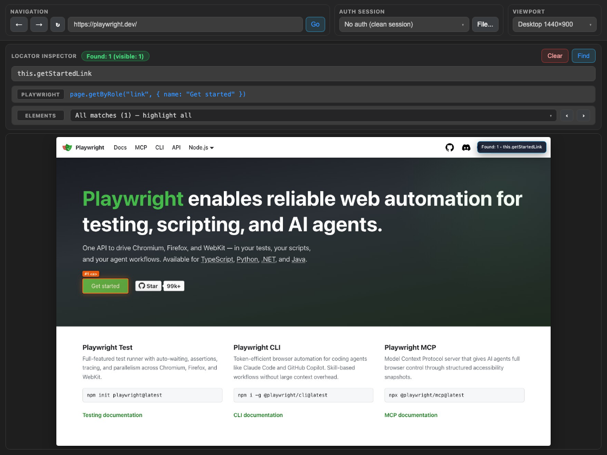
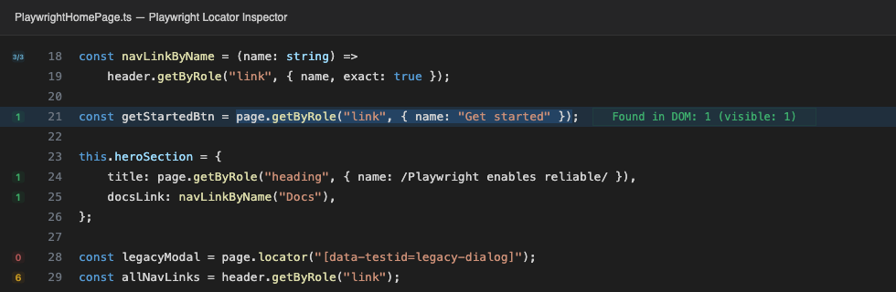

# Playwright Locator Inspector

[English](#english) | [Русский](#русский)

---

<a id="english"></a>

## **English**

A VS Code extension that embeds an interactive Chromium browser inside an editor tab and provides real-time Playwright locator inspection, DOM match counts in the editor gutter, and live element highlighting directly from code (Page Objects, helpers, and tests).

> **Note — Supported Languages:** Currently, **only TypeScript/JavaScript** (`.ts`, `.tsx`, `.js`, `.jsx`; `.mjs`/`.cjs` are also recognized during file scanning, while editor toolbar and context menu actions are bound to `.ts`/`.tsx`/`.js`/`.jsx`) is supported. Python, Java, C#, and other Playwright languages are not supported yet.

---

### **How It Works**

The extension launches Chromium from your workspace Playwright installation, renders the page directly inside a VS Code editor tab, resolves the locator chain from your TypeScript code (`this.*` properties, Page Objects, helpers, or direct selectors), and highlights matching DOM elements with a live match count.

<picture>
  <source media="(prefers-color-scheme: light)" srcset="https://raw.githubusercontent.com/RudoySergeyA/pw-locator-inspector/main/assets/preview-inspector-light.png" />
  
</picture>

#### **Live Editor Gutter & Selection Feedback**

While the inspector browser is open, match counts appear directly in the left editor gutter and update dynamically as you type or navigate. Selecting a locator expression also shows a subtle inline match counter on the right (when the browser tab is closed, gutter badges are cleared, while selecting a locator shows a neutral `Inspector browser is closed` hint until you clear the selection).



---

### **Prerequisites**

- **VS Code** `^1.85.0` (opened in a **Trusted Workspace**).
- **Playwright** installed in your project's `node_modules` (`@playwright/test`, `playwright`, or `playwright-core`).
- **Chromium** browser binaries installed for Playwright:
  ```bash
  npx playwright install chromium
  ```

---

### **Features**

- **Embedded Interactive Browser** (`Playwright: Open Browser Inspector`):
  - Live browser view streamed over CDP Screencast (`Page.startScreencast` + `Page.screencastFrameAck`) with mouse, scroll, and keyboard forwarding.
  - **Navigation** bar with Back, Forward, Reload, and URL input (supports relative paths like `/login`, resolved against `baseURL`).
  - **Auth session** selector that automatically detects valid Playwright `storageState` `.json` files (checks `.auth/`, `playwright/.auth/`, `auth/`, `e2e/.auth/`, `tests/.auth/`, and workspace files up to depth 3; auto-selects the first valid file from `.auth/` or `playwright/.auth/`; validates `cookies` / `origins` schemas, shows counts on hover, skips secret-named JSON files, and lets you pick any custom file via **File...**).
  - **Viewport** switcher (`Desktop 1440×900`, `Desktop 1920×1080`, `Mobile 393×851`) with aspect-ratio-preserving preview scaling.
  - Adapts automatically to VS Code **Light** and **Dark** themes.

- **Locator Inspector & Snippet Search**:
  - Click **Show Locator in Browser** from the editor context menu (or press `Cmd+Shift+L` / `Ctrl+Shift+L`) on any locator in code.
  - Paste any Playwright locator chain, Page Object property, leading-dot chain (`.locator(...)`), prefix-less call (`getByTestId(...)`), or CSS/XPath selector into the **Locator inspector** input and press `Enter` or **Find**. Multi-line code and `//` / `/* */` comments are compacted automatically on paste.
  - Highlights matched elements in the browser with an orange overlay, displays total and visible counts (`visible: N`), scrolls the target element to the center of the viewport (accounting for fixed/sticky headers), briefly highlights the active expression in the editor, and provides a **Clear** button to dismiss the overlay.
  - Automatically re-runs and re-highlights the active locator after page navigation and client-side SPA route changes (`pushState` / `replaceState`).
  - Switch between matched elements via the **Elements** dropdown (with `.first()` / `.last()` / `.nth(i)` hints), and test parameterized helpers/methods via variant chips or custom parameter input.

- **Safe AST Locator Resolver (`line + column`)**:
  - Analyzes the live editor buffer (`document.getText()`), including unsaved changes.
  - Distinguishes nested vs. outer locators at the cursor position.
  - Safely strips terminal action/assertion calls (`.click()`, `.fill()`, `.check()`, `.hover()`, `.press()`, `.waitFor()`, `expect(...).toBeVisible()`, etc.) so elements are highlighted without side effects.
  - Supports `frameLocator`, `contentFrame`, `.filter()`, `.and()`, `.or()`, `this.*` properties, nested section objects, constructor variables, local factory functions, and imported constant objects.

- **Live Editor Feedback**:
  - **Gutter counters** on the left automatically scan all locators in the active editor while the browser tab is open, update dynamically while typing or navigating, and clear immediately when the browser tab closes:
    - Green (`1`) — unique match in DOM
    - Amber (`2+`) — multiple matches in DOM
    - Red (`0`) — not found in DOM
    - Blue (`N/M`) — parameterized helper variants matched
  - Hovering a gutter badge displays the resolved Playwright chain and a clickable **Highlight in browser** link.
  - Selecting a locator fragment shows a subtle inline match badge on the right (or `Inspector browser is closed` when the browser tab is not open).

- **Zero Bundled Browsers & Project Config Integration**:
  - Dynamically uses `@playwright/test`, `playwright`, or `playwright-core` from your workspace `node_modules`.
  - Reads `use.testIdAttribute`, `use.baseURL`, `use.ignoreHTTPSErrors`, `use.viewport`, `use.launchOptions.args`, and safe static `use.extraHTTPHeaders` from `playwright.config.{ts,js,mjs,cjs}`.
  - Optionally resolves non-sensitive URL/config variables (`BASE_URL`, `QA_URL`, etc.) from `.env*` files when `pwLocatorInspector.readEnvFiles` is enabled.

---

### **Usage**

1. Open a Playwright TypeScript/JavaScript Page Object, helper, or test file (`.ts`, `.tsx`, `.js`, `.jsx`).
2. Open the **Playwright Browser Inspector** tab using the Inspector button in the editor title bar (`Playwright: Open Browser Inspector`) or via the Command Palette (`Cmd+Shift+P` / `Ctrl+Shift+P`).
3. Optionally choose a `storageState` file under **Auth session** and navigate to the target URL.
4. View live match counts in the editor gutter, select any locator snippet for quick inline verification, or right-click a locator and choose **Show Locator in Browser** (`Cmd+Shift+L` / `Ctrl+Shift+L`).

---

### **Extension Settings**

| Setting | Default | Description |
| --- | --- | --- |
| `pwLocatorInspector.viewportWidth` | `1440` | Default browser viewport width. |
| `pwLocatorInspector.viewportHeight` | `900` | Default browser viewport height. |
| `pwLocatorInspector.storageStatePath` | `""` | Relative or absolute path to a Playwright `storageState` (`.json`) file. |
| `pwLocatorInspector.readEnvFiles` | `false` | Opt-in: allow reading non-sensitive URL/config variables (e.g. `BASE_URL`, `QA_URL`) from workspace `.env*` files. Sensitive keys (tokens, passwords, secrets, auth, keys) are always ignored. |

---

### **Security & Privacy**

- **Requires Trusted Workspace:** The extension is disabled in VS Code untrusted workspaces (`untrustedWorkspaces: false`) because it executes Playwright from workspace `node_modules`.
- **Safe `.env` handling:** Workspace `.env*` files are **not read by default** (`pwLocatorInspector.readEnvFiles: false`). Even when enabled, keys matching sensitive patterns (`*SECRET*`, `*TOKEN*`, `*PASS*`, `*KEY*`, `*AUTH*`, `*COOKIE*`, `*SESSION*`, `*CRED*`, `*PRIVATE*`, etc.) and URLs containing embedded credentials (`user:pass@`) are ignored; nothing is logged or sent externally.
- **Scoped `extraHTTPHeaders`:** Sensitive headers (`Authorization`, `Cookie`, `X-API-Key`, etc.) and `process.env.*` lookups inside `extraHTTPHeaders` are stripped. Remaining static headers are attached strictly to same-origin requests matching `baseURL`, preventing leakage to third-party domains.
- **Safe `storageState` scanning:** Secret-named JSON files (e.g. `credentials.json`, `secrets.json`, `service-account*.json`) are skipped during auto-discovery, and cookie/localStorage contents are never sent to the Webview UI.
- **No telemetry:** All processing runs locally inside VS Code and your local Playwright Chromium instance.

---

### **Limitations & Troubleshooting**

- **Chromium only:** The embedded browser always uses Playwright's Chromium engine (Firefox and WebKit projects from `playwright.config` are not used).
- **Browser input limits:** Left-click, double-click, hover, wheel scroll, and regular text typing are forwarded to the page. `Cmd`/`Ctrl` shortcuts are intentionally left to VS Code (so `Cmd+C`/`Cmd+V` won't copy/paste inside page inputs), and in-page context menus / DevTools are not embedded.
- **Dynamic runtime locators:** Because resolution uses static AST analysis, locators constructed purely from runtime API responses or complex dynamic loops cannot be resolved automatically — use the custom **Parameter** input or paste a concrete snippet into **Locator inspector**.
- **Common errors:**
  - *Could not find `@playwright/test`, `playwright`, or `playwright-core`*: run `npm install` in your Playwright project workspace.
  - *Executable doesn't exist / browser fails to launch*: run `npx playwright install chromium` in the workspace.
  - *Invalid `storageState` file*: ensure the JSON file is a valid Playwright storage state containing `cookies` and/or `origins` arrays.

---

### **License & Credits**

Licensed under the [MIT License](LICENSE).

Created by **Rudoi S.** with AI assistance.
Repository: [github.com/RudoySergeyA/pw-locator-inspector](https://github.com/RudoySergeyA/pw-locator-inspector) · [Report an Issue](https://github.com/RudoySergeyA/pw-locator-inspector/issues)

---

<a id="русский"></a>

## **Русский**

Расширение для VS Code, которое открывает интерактивный браузер Chromium прямо во вкладке редактора, показывает количество совпадений локаторов в реальном времени и подсвечивает найденные элементы на странице прямо из кода (Page Object, хелперы, тесты).

> **Важно — поддерживаемые языки:** Пока поддерживается **только TypeScript/JavaScript** (`.ts`, `.tsx`, `.js`, `.jsx`; при сканировании файлов также поддерживаются `.mjs`/`.cjs`, но кнопки в заголовке и контекстное меню привязаны к `.ts`/`.tsx`/`.js`/`.jsx`). Python, Java, C# и другие языки Playwright пока не поддерживаются.

---

### **Как это работает**

Расширение запускает Chromium из Playwright вашего проекта, отображает страницу прямо во вкладке VS Code, раскручивает цепочку локатора из TypeScript-кода (`this.*`, Page Object, хелперы или ручной ввод) и подсвечивает найденные элементы в DOM с точным количеством совпадений.

<picture>
  <source media="(prefers-color-scheme: light)" srcset="https://raw.githubusercontent.com/RudoySergeyA/pw-locator-inspector/main/assets/preview-inspector-light.png" />
  
</picture>

#### **Индикация в редакторе (gutter слева и бейдж при выделении)**

Пока открыто окно браузера инспектора, слева от номеров строк автоматически отображается количество найденных в DOM элементов для каждого локатора в файле, а при написании нового локатора счётчики обновляются динамически. При выделении фрагмента локатора справа выводится мягкий инлайн-бейдж с числом совпадений. При закрытии окна браузера счётчики в gutter сразу убираются, а при выделении локатора показывается нейтральная подсказка `Inspector browser is closed` (исчезает при снятии выделения).


---

### **Требования**

- **VS Code** версии `^1.85.0` (папка проекта должна быть открыта в режиме **Trusted Workspace**).
- Установленный **Playwright** в `node_modules` рабочего проекта (`@playwright/test`, `playwright` или `playwright-core`).
- Скачанный браузер **Chromium** для Playwright:
  ```bash
  npx playwright install chromium
  ```

---

### **Возможности**

- **Встроенный интерактивный браузер** (`Playwright: Open Browser Inspector`):
  - Живой поток экрана через CDP Screencast (`Page.startScreencast` + `Page.screencastFrameAck`) с пробросом кликов, скролла и клавиатурного ввода.
  - Блок **Navigation**: кнопки «Назад», «Вперёд», «Обновить» и адресная строка (поддерживает относительные пути вида `/login`, которые автоматически склеиваются с `baseURL`).
  - Блок **Auth session**: автоматический поиск валидных файлов `storageState` (сканирует `.auth/`, `playwright/.auth/`, `auth/`, `e2e/.auth/`, `tests/.auth/` и проект до глубины 3; автоматически выбирает первый валидный файл из `.auth/` или `playwright/.auth/`; проверяет схему `cookies` / `origins`, выводит их количество в подсказке, пропускает секретные JSON-файлы и позволяет выбрать произвольный файл через **File...**).
  - Блок **Viewport**: переключение разрешений (`Desktop 1440×900`, `Desktop 1920×1080`, `Mobile 393×851`) с сохранением пропорций экрана.
  - Адаптация интерфейса под **светлую** и **тёмную** темы VS Code.

- **Инспектор локатора и ручной поиск** (**Locator inspector**):
  - Вызов по правой кнопке мыши **Show Locator in Browser** или сочетанием `Cmd+Shift+L` / `Ctrl+Shift+L` на любом локаторе в коде.
  - Поддержка вставки готовых цепочек Playwright, обращений к свойствам, фрагментов с ведущей точкой (`.locator(...)`), вызовов без `page.` (`getByTestId(...)`) и чистых CSS/XPath-селекторов. При вставке многострочный код и комментарии (`//`, `/* */`) очищаются автоматически.
  - Визуальная подсветка найденных элементов оранжевым оверлеем, отображение общего и видимого числа совпадений (`visible: N`), автоскролл к центру экрана (с поправкой под fixed/sticky-шапки), кратковременная подсветка выражения в редакторе и кнопка **Clear** для снятия подсветки.
  - Автоматический перезапуск поиска и переподсветка активного локатора после навигации и клиентских SPA-переходов (`pushState` / `replaceState`).
  - Переключение между найденными элементами через выпадающий список **Elements** (с подсказками `.first()` / `.last()` / `.nth(i)`).
  - Поддержка параметризованных методов и хелперов (выбор готовых вариантов или ввод своего значения параметра).

- **Безопасный AST-резолвер (`line + column`)**:
  - Анализирует актуальный текст редактора (`document.getText()`), даже если файл ещё не сохранён.
  - Точно различает вложенные и внешние локаторы по позиции курсора.
  - Безопасно отрезает терминальные действия и проверки (`.click()`, `.fill()`, `.check()`, `.hover()`, `.press()`, `.waitFor()`, `expect(...).toBeVisible()` и др.), чтобы подсветить элемент без побочных эффектов на странице.
  - Поддерживает `frameLocator`, `contentFrame`, `.filter()`, `.and()`, `.or()`, раскрутку `this.*`, вложенных секций, локальных переменных конструктора, фабрик-хелперов и импортированных констант.

- **Живая проверка локаторов в редакторе**:
  - **Счётчики слева в gutter** автоматически анализируют все локаторы открытого файла при запуске инспектора, обновлении страницы или редактировании кода и полностью очищаются после закрытия вкладки браузера:
    - Зелёный (`1`) — уникальное совпадение в DOM;
    - Янтарный (`2+`) — найдено несколько элементов;
    - Красный (`0`) — элемент отсутствует в DOM;
    - Голубой (`N/M`) — совпадения по вариантам параметризованного хелпера.
  - При наведении на бейдж слева отображается подсказка с развёрнутым локатором и кликабельной ссылкой **Highlight in browser**.
  - При выделении участка локатора справа от строки выводится полупрозрачный инлайн-бейдж с результатом проверки в DOM (или `Inspector browser is closed`, если вкладка браузера закрыта).

- **Без вшитых браузеров и интеграция с конфигом проекта**:
  - Динамически подключает `@playwright/test` / `playwright` / `playwright-core` из `node_modules` текущего проекта.
  - Читает `use.testIdAttribute`, `use.baseURL`, `use.ignoreHTTPSErrors`, `use.viewport`, `use.launchOptions.args` и безопасные статические `use.extraHTTPHeaders` из `playwright.config.{ts,js,mjs,cjs}`.
  - При включении настройки `pwLocatorInspector.readEnvFiles` подхватывает нечувствительные URL-переменные (`BASE_URL`, `QA_URL` и др.) из `.env*` файлов проекта.

---

### **Использование**

1. Откройте файл Page Object, хелпера или теста на TypeScript/JavaScript (`.ts`, `.tsx`, `.js`, `.jsx`).
2. Откройте вкладку **Playwright Browser Inspector** кнопкой инспектора в заголовке открытого файла (`Playwright: Open Browser Inspector`) или через палитру команд (`Cmd+Shift+P` / `Ctrl+Shift+P`).
3. При необходимости выберите `storageState` в блоке **Auth session** и перейдите на нужный URL.
4. Смотрите количество совпадений слева в gutter, выделяйте фрагменты локаторов для быстрой проверки справа или вызывайте **Show Locator in Browser** (`Cmd+Shift+L` / `Ctrl+Shift+L`) для визуальной подсветки на странице.

---

### **Настройки расширения**

| Параметр | По умолчанию | Описание |
| --- | --- | --- |

| `pwLocatorInspector.viewportWidth` | `1440` | Ширина viewport встроенного браузера по умолчанию. |
| `pwLocatorInspector.viewportHeight` | `900` | Высота viewport встроенного браузера по умолчанию. |
| `pwLocatorInspector.storageStatePath` | `""` | Относительный или абсолютный путь к файлу `storageState` (`.json`). |
| `pwLocatorInspector.readEnvFiles` | `false` | По желанию: разрешить чтение нечувствительных переменных (например, `BASE_URL`, `QA_URL`) из `.env*` проекта. Секретные ключи (токены, пароли, ключи, auth) всегда игнорируются. |

---

### **Безопасность и приватность**

- **Только доверенные воркспейсы:** Расширение отключено в недоверенных папках VS Code (`untrustedWorkspaces: false`), так как запускает Playwright из `node_modules` проекта.
- **Безопасная работа с `.env`:** По умолчанию файлы `.env*` **не читаются** (`pwLocatorInspector.readEnvFiles: false`). Даже при включении настройки переменные с чувствительными именами (`*SECRET*`, `*TOKEN*`, `*PASS*`, `*KEY*`, `*AUTH*`, `*COOKIE*`, `*SESSION*`, `*CRED*`, `*PRIVATE*` и др.) и URL со встроенными кредами (`user:pass@`) отбрасываются; значения никуда не логируются и не отправляются.
- **Защита `extraHTTPHeaders`:** Чувствительные заголовки (`Authorization`, `Cookie`, `X-API-Key` и т.п.) и подстановки `process.env.*` в `extraHTTPHeaders` вырезаются. Оставшиеся статические заголовки отправляются строго на same-origin целевого `baseURL` и не утекают на сторонние домены.
- **Безопасный поиск `storageState`:** Файлы с секретными именами (`credentials.json`, `secrets.json`, `service-account*.json`) пропускаются при автопоиске, а содержимое cookies и localStorage никогда не передаётся в UI Webview.
- **Без телеметрии:** Вся работа происходит локально внутри VS Code и локального Chromium.

---

### **Ограничения и решение проблем**

- **Только Chromium:** Встроенный браузер всегда запускает Chromium из Playwright (проекты Firefox и WebKit из `playwright.config` не используются).
- **Ограничения ввода в браузере:** Пробрасываются левый клик, двойной клик, наведение, скролл колёсиком и обычный набор текста. Комбинации с `Cmd`/`Ctrl` намеренно остаются за VS Code (поэтому `Cmd+C`/`Cmd+V` внутри полей страницы не сработают); контекстное меню страницы и встроенный DevTools отсутствуют.
- **Динамические рантайм-локаторы:** Поскольку используется статический AST-анализ, локаторы, собираемые только из ответов API или сложных динамических циклов, автоматически не вычисляются — используйте поле **Parameter** для ввода значения или вставьте конкретный фрагмент в **Locator inspector**.
- **Частые ошибки:**
  - *Could not find `@playwright/test`, `playwright`, or `playwright-core`* — выполните `npm install` в корне Playwright-проекта.
  - *Executable doesn't exist / браузер не запускается* — выполните `npx playwright install chromium`.
  - *Invalid `storageState` file* — убедитесь, что JSON-файл соответствует формату Playwright `storageState` (содержит валидные массивы `cookies` и/или `origins`).

---

### **Лицензия и авторство**

Распространяется по лицензии [MIT](LICENSE).

Создано **Rudoi S.** при помощи AI.
Репозиторий: [github.com/RudoySergeyA/pw-locator-inspector](https://github.com/RudoySergeyA/pw-locator-inspector) · [Сообщить о проблеме](https://github.com/RudoySergeyA/pw-locator-inspector/issues)
