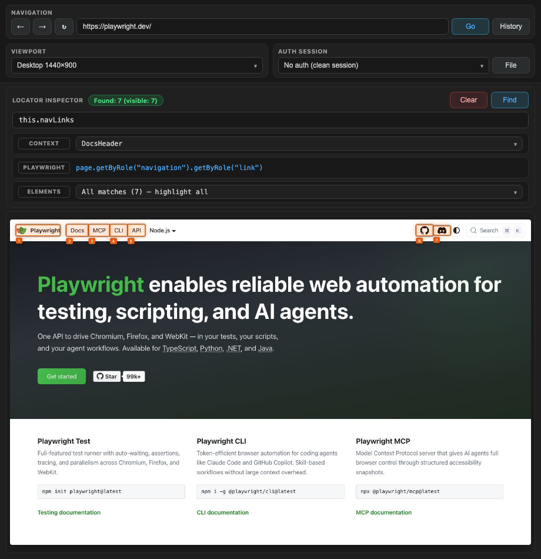
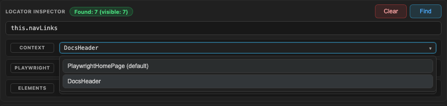

# Playwright Locator Inspector

[English](#english) | [Русский](#русский)

## English

Test and debug Playwright locators directly inside VS Code without running a test suite. Playwright Locator Inspector opens an interactive Chromium tab in the editor, resolves locators from your TypeScript or JavaScript code, and highlights matching DOM elements live on the page.

### Features

- **Embedded browser**: Open any URL inside a VS Code tab, switch between Desktop and Mobile **Viewport** presets, revisit recent pages in **History**, and interact with the page using mouse, scroll, and keyboard.
- **Live locator highlighting**: Choose **Show Locator in Browser** (`Cmd+Shift+L` on macOS, `Ctrl+Shift+L` on Windows/Linux) from code or paste a Playwright locator, CSS selector, or XPath into **Locator inspector** to highlight matches on the page and jump between individual **Elements**.
- **Works with Page Objects & helpers**: Resolves locators directly from `.ts`, `.tsx`, `.js`, and `.jsx` files (including unsaved edits, constants, frames, and chained filters) without running `.click()` or `expect(...)` calls.
- **Parameters & context switching**: Switch between detected values for parameterized helpers and Page Object **Context** variants right inside the inspector.
- **Live counts in the editor**: See match counts in the left gutter (`1`, `2+`, `0`, `N/M`) and inline next to your selection while the inspector is open.
- **Project config & auth**: Automatically picks up `testIdAttribute` and Playwright `storageState` auth files from your project, or lets you pick a session file manually via **File**.

### Requirements

- **VS Code** `1.85.0` or later in a **Trusted Workspace**
- Playwright and its browser binaries (Chromium) installed in the project

### Quick start

1. Open a TypeScript or JavaScript test, helper, or Page Object (`.ts`, `.tsx`, `.js`, `.jsx`).
2. Launch the extension in one of two ways:
   - From the Command Palette (`Cmd+Shift+P` / `Ctrl+Shift+P`): run **Playwright: Open Browser Inspector**.
   - Or place the cursor on a locator and press `Cmd+Shift+L` (`Ctrl+Shift+L` on Windows/Linux), or right-click and select **Show Locator in Browser** from the context menu.
3. Enter a URL and click **Go**. Choose a **Viewport** or **Auth session** if needed.

### Editor feedback

- **Gutter badges**: Green `1` indicates a unique match, amber (`2`–`99+`) indicates multiple matches, red `0` indicates no match on the current page, and blue `N/M` indicates how many parameter variants matched. Closing the inspector clears all gutter badges.
- **Re-evaluation**: The active locator and gutter counts automatically re-check after navigation, reload, viewport changes, and client-side route updates.

### Settings & privacy

| Setting | Default | Description |
| --- | --- | --- |
| `pwLocatorInspector.viewportWidth` | `1440` | Initial browser viewport width. |
| `pwLocatorInspector.viewportHeight` | `900` | Initial browser viewport height. |
| `pwLocatorInspector.storageStatePath` | `""` | Relative or absolute path to a Playwright `storageState` JSON file. |
| `pwLocatorInspector.readEnvFiles` | `false` | Opt in to reading non-sensitive URL variables (such as `BASE_URL`) from workspace `.env*` files. |

All inspection runs locally using your trusted workspace's Playwright package with no telemetry. Sensitive headers (`Authorization`, `Cookie`, `X-API-Key`, etc.), secret-named JSON files, and sensitive `.env*` keys are excluded; allowed static headers are sent only to the `baseURL` origin.

### Scope & troubleshooting

- The embedded browser runs Chromium only, and `Cmd`/`Ctrl` shortcuts remain handled by VS Code.
- Runtime-only locators and non-JS/TS Playwright languages are not statically resolved — paste a concrete Playwright expression or selector into **Locator inspector** to test dynamic values.
- **Chromium fails to launch**: run `npx playwright install chromium` in your project root.
- **Auth file rejected**: ensure the JSON file is a valid Playwright `storageState` with `cookies` and/or `origins` arrays.

---

## Русский

Проверяйте и отлаживайте локаторы Playwright прямо в VS Code без запуска тестов. Расширение открывает интерактивный Chromium во вкладке редактора, разбирает локаторы из TypeScript или JavaScript и подсвечивает совпадения на текущей странице.

### Возможности

- **Встроенный браузер**: открывает страницы прямо во вкладке VS Code, переключает **Viewport** (десктоп и мобильный), хранит **History** недавних адресов и поддерживает клики, скролл и ввод с клавиатуры.
- **Подсветка локаторов на странице**: выберите **Show Locator in Browser** (`Cmd+Shift+L` на macOS, `Ctrl+Shift+L` на Windows/Linux) из кода или вставьте локатор Playwright, CSS или XPath в **Locator inspector**, чтобы увидеть все совпадения и переключаться по **Elements**.
- **Работа с Page Object и хелперами**: понимает `.ts`, `.tsx`, `.js` и `.jsx` файлы с учётом несохранённых правок, констант, фреймов и цепочек фильтров — без реального выполнения `.click()` или `expect(...)`.
- **Параметры и контекст**: позволяет переключать варианты значений для параметризованных хелперов и наследуемых классов прямо в инспекторе (**Context**).
- **Счётчики в редакторе**: показывает число совпадений слева от строк (`1`, `2+`, `0`, `N/M`) и справа при выделении локатора, пока открыта вкладка инспектора.
- **Настройки и авторизация из проекта**: автоматически подхватывает `testIdAttribute` и файлы авторизации `storageState` (либо позволяет выбрать файл вручную через **File**).

### Требования

- **VS Code** версии `1.85.0` или новее в **доверенной рабочей области** (Trusted Workspace)
- Установленный в проекте Playwright и загруженные браузеры (Chromium)

### Быстрый старт

1. Откройте тест, хелпер или Page Object на TypeScript или JavaScript (`.ts`, `.tsx`, `.js`, `.jsx`).
2. Запустите расширение одним из способов:
   - Через палитру команд (`Cmd+Shift+P` / `Ctrl+Shift+P`): введите **Playwright: Open Browser Inspector**.
   - Либо поставьте курсор на локатор в коде и нажмите `Cmd+Shift+L` (`Ctrl+Shift+L` на Windows/Linux) или через ПКМ выберите **Show Locator in Browser** в контекстном меню.
3. Введите URL и нажмите **Go**. При необходимости выберите **Viewport** и **Auth session**.

### Индикация в редакторе

- **Счётчики слева**: зелёный `1` — одно совпадение, янтарный (`2`–`99+`) — несколько совпадений, красный `0` — элемент не найден на текущей странице, синий `N/M` — сколько вариантов параметра сработали. При закрытии инспектора счётчики исчезают.
- **Автообновление**: активный локатор и счётчики пересчитываются автоматически после навигации, перезагрузки, смены viewport и клиентских переходов.

### Настройки и безопасность

| Параметр | По умолчанию | Назначение |
| --- | --- | --- |
| `pwLocatorInspector.viewportWidth` | `1440` | Начальная ширина viewport. |
| `pwLocatorInspector.viewportHeight` | `900` | Начальная высота viewport. |
| `pwLocatorInspector.storageStatePath` | `""` | Относительный или абсолютный путь к файлу `storageState`. |
| `pwLocatorInspector.readEnvFiles` | `false` | Разрешает чтение нечувствительных URL-переменных (например, `BASE_URL`) из `.env*` проекта. |

Вся работа выполняется локально с использованием Playwright из доверенного проекта, без телеметрии. Чувствительные заголовки (`Authorization`, `Cookie`, `X-API-Key` и др.), JSON-файлы с секретными именами и чувствительные ключи `.env*` игнорируются; разрешённые статические заголовки отправляются только на origin из `baseURL`.

### Ограничения и частые вопросы

- Встроенный браузер всегда использует Chromium, а сочетания клавиш с `Cmd`/`Ctrl` остаются за VS Code.
- Локаторы, зависящие от данных времени выполнения, и другие языки Playwright статически не разбираются — для проверки подставьте конкретное выражение или селектор в поле **Locator inspector**.
- **Chromium не запускается**: выполните `npx playwright install chromium` в корне проекта.
- **Файл авторизации отклонён**: убедитесь, что это валидный Playwright `storageState` JSON с массивами `cookies` и/или `origins`.

---

[MIT License](LICENSE) · [GitHub](https://github.com/RudoySergeyA/pw-locator-inspector) · [Report an issue / Сообщить о проблеме](https://github.com/RudoySergeyA/pw-locator-inspector/issues)
